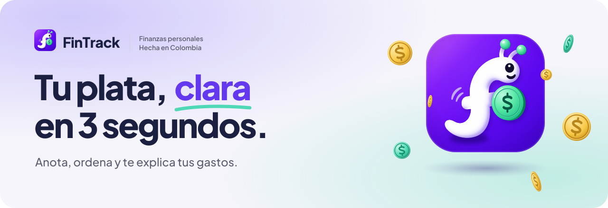
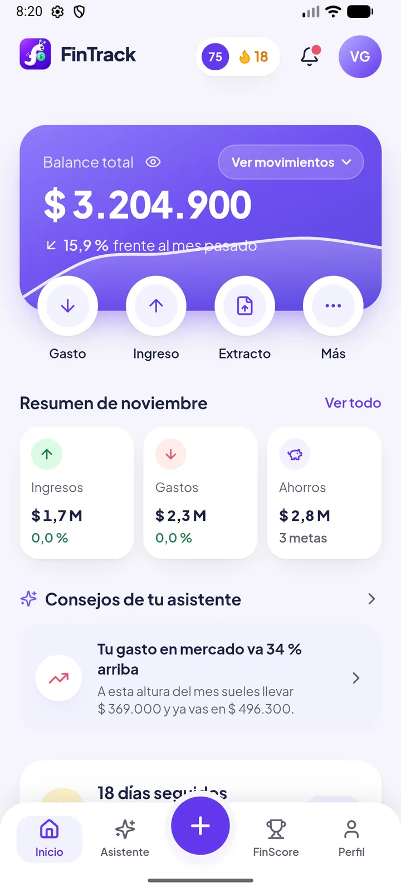
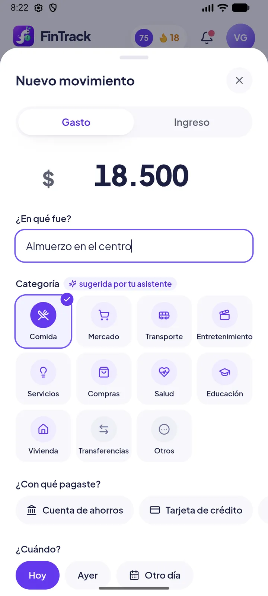
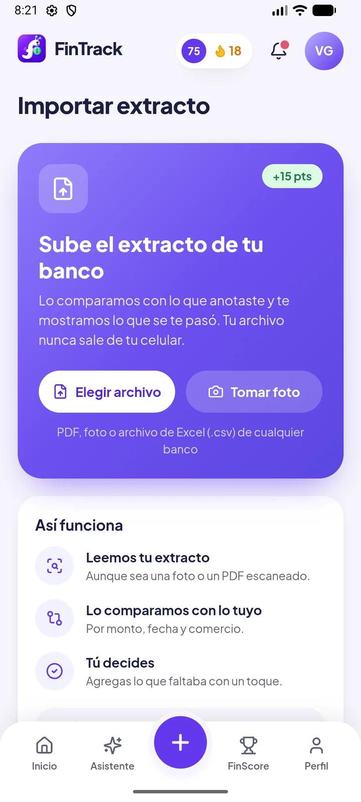
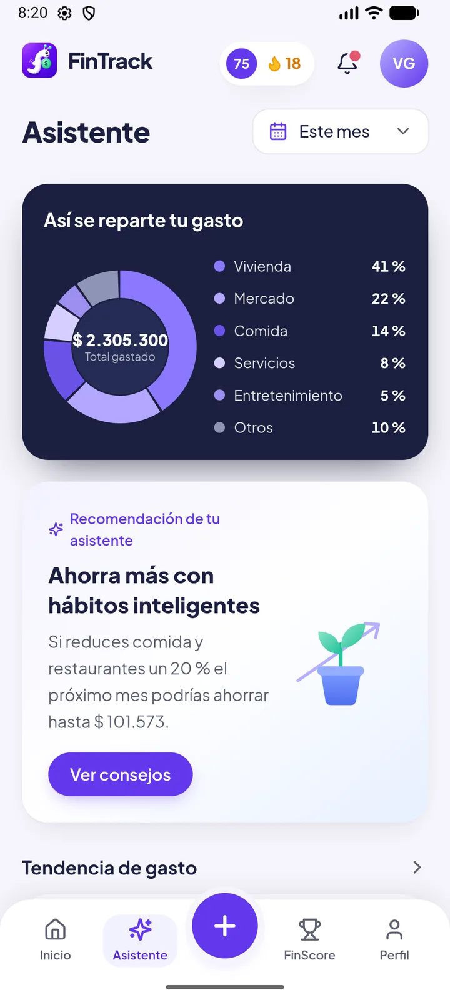

<p align="center">
  
</p>

<p align="center">
  <b>Finanzas personales para jóvenes adultos en Colombia.</b><br>
  Anotas en segundos, tu extracto completa lo que se te pasó, un asistente te explica en qué se va la plata<br>
  y el FinScore convierte la constancia en recompensas.
</p>

<p align="center">
  
  
  
  
  
</p>

<p align="center">
  <a href="#equipo">Equipo</a> ·
  <a href="#qué-hace">Qué hace</a> ·
  <a href="#inicio-rápido">Inicio rápido</a> ·
  <a href="#cómo-está-hecha">Cómo está hecha</a> ·
  <a href="#despliegue">Despliegue</a> ·
  <a href="#integración-continua">Integración continua</a>
</p>

## Equipo

<table align="center">
  <tr>
    <td align="center" width="200">
      <a href="https://github.com/TesterRB"><br><b>Juan David Reyes</b></a><br>
      <sub><a href="https://github.com/TesterRB">@TesterRB</a></sub>
    </td>
    <td align="center" width="200">
      <a href="https://github.com/Majo0209"><br><b>Maria José Suarez</b></a><br>
      <sub><a href="https://github.com/Majo0209">@Majo0209</a></sub>
    </td>
    <td align="center" width="200">
      <a href="https://github.com/MarcAragon"><br><b>Marco Antonio Aragon</b></a><br>
      <sub><a href="https://github.com/MarcAragon">@MarcAragon</a></sub>
    </td>
    <td align="center" width="200">
      <a href="https://github.com/nicolevrv"><br><b>Nicole Valeria Ruiz</b></a><br>
      <sub><a href="https://github.com/nicolevrv">@nicolevrv</a></sub>
    </td>
  </tr>
</table>

## Qué hace

<table>
  <tr>
    <td width="50%" valign="top">
      
      <h3>Anotas en 3 segundos</h3>
      Escribes «almuerzo 18.000» y listo. Un clasificador que corre en el dispositivo pone la categoría y aprende de cada corrección.
    </td>
    <td width="50%" valign="top">
      
      <h3>Tu extracto llena los huecos</h3>
      Subes el PDF, CSV o una foto del extracto; FinTrack lo compara con lo que anotaste y agrega lo que se te pasó, sin conectar tu banco.
    </td>
  </tr>
  <tr>
    <td width="50%" valign="top">
      
      <h3>Entiendes en qué se va la plata</h3>
      Gastos hormiga, suscripciones, cobros dobles y cómo podría cerrar tu mes. Cada consejo trae los movimientos que lo prueban.
    </td>
    <td width="50%" valign="top">
      
      <h3>Tu constancia vale plata</h3>
      Un puntaje mensual de 0 a 100 premia volver cada día: con 85 puntos ganas un cupón y con 100, además, días Premium.
    </td>
  </tr>
</table>

<p align="center">
  &nbsp;
  &nbsp;
  &nbsp;
  
  <br>
  <sub>Inicio · Registro rápido · Importar extracto · Asistente</sub>
</p>

## Inicio rápido

Requisitos: **Node.js 22** (la versión que usa el CI) y npm.

```bash
npm install
npm run dev        # http://localhost:5173
```

Sin variables de entorno la app arranca en **modo demo**: todo vive en el navegador (localStorage). «Entrar» con cualquier correo carga un perfil de ejemplo con 4 meses de movimientos, y en la demo el usuario también es administrador para probar el Panel de aliados. Para conectarla a Supabase, copia `.env.example` como `.env.local` y llena los valores.

<details>
<summary><b>Todos los scripts</b></summary>

| Comando | Qué hace |
|---|---|
| `npm run dev` | Servidor de desarrollo con recarga en caliente |
| `npm run build` | Revisa los tipos (`tsc -b`) y genera el build de producción en `dist/` |
| `npm run preview` | Sirve el build de `dist/` para probarlo |
| `npm test` | Pruebas del motor: clasificador, extractos, conciliación, OCR de facturas y FinScore |
| `npm run lint` | ESLint sobre el código TypeScript/React |
| `npm run android:sync` | Build web + copia al proyecto Android |
| `npm run android:abrir` | Abre el proyecto en Android Studio |
| `npm run android:apk` | Build web + sync + APK firmado en `release/` (necesita la firma, ver [docs/BETA.md](docs/BETA.md)) |
| `npm run android:iconos` | Regenera ícono, splash y silueta desde `public/logo.svg` |

</details>

## Cómo está hecha

| Pieza | Tecnología |
|---|---|
| **Web** | React 19, TypeScript, Vite y Tailwind; desplegable gratis en Vercel. La landing usa three.js para sus elementos 3D |
| **Android** | Capacitor 8: el mismo código web dentro de un contenedor nativo (carpeta `android/`). Guía de la beta: [docs/BETA.md](docs/BETA.md) |
| **Backend** | Supabase (plan gratuito): Auth con correo y Google, Postgres con RLS, Storage, `pg_cron` y monitoreo propio |
| **Pagos** | Wompi (sandbox) con firma de integridad y webhook verificado |
| **IA** | Modelos propios que corren en el dispositivo: sin LLM y sin costo por uso |

```
src/
  main.tsx, App.tsx   arranque y rutas (con y sin sesión)
  pages/              una pantalla por archivo: Inicio, Movimientos, Insights (Asistente), Presupuestos,
                      Extractos, FinScore, Promociones, Planes, Perfil, Notificaciones, Admin, Acceso, Landing
    landing/          escena 3D de la landing (three.js: celular, monedas y logo en volumen)
  components/         interfaz reutilizable (ui.tsx), marco con navegación, registro rápido, paneles, íconos
  hooks/              analítica derivada del mes (useAnalitica) y avisos (useNotificaciones)
  store/              estado global con zustand: datos y acciones (app.ts) e interfaz (ui.ts)
  data/               capa de datos intercambiable: contrato (backend.ts), demo (localStorage) y Supabase
  ml/                 modelos y lectores de documentos, sin dependencias de servidor (+ pruebas)
  lib/                tipos del dominio, formato COP y fechas, planes, FinScore, estímulos, telemetría
supabase/
  migrations/         esquema, RLS, FinScore autoritativo, monitoreo (se aplican en orden)
  functions/          Edge Functions de Wompi (firma del checkout y webhook)
  correos/            plantillas de correo en español (confirmación y recuperación)
  seed.sql            aliados y promociones de ejemplo (ficticios, opcional)
public/               logo y capturas reales de la app que muestra la landing (landing/*.webp)
android/              proyecto nativo de Capacitor
scripts/              compilación del APK y generación de íconos
docs/                 guía de la beta, gamificación e imágenes de este README
```

### Cómo encaja

- **La app nunca habla directo con Supabase ni con localStorage**: todo pasa por la interfaz `Backend` (`src/data/backend.ts`). `src/data/index.ts` elige la implementación según las variables de entorno.
- **Cambios optimistas**: el store (`src/store/app.ts`) aplica cada cambio en pantalla y luego lo guarda; si falla, lo revierte y avisa.
- **La seguridad está en la base de datos**: la llave anónima es pública por diseño. Las políticas RLS limitan a cada usuario a sus filas y el servidor recalcula lo que da premios o cobra dinero (FinScore, validación de facturas, monto de los pagos).
- **Reglas duplicadas a propósito**: el FinScore existe en TypeScript (`src/lib/finscore.ts`, para mostrarlo al instante) y en SQL (`finscore_mes`, el que emite recompensas). Los precios están en `src/lib/planes.ts` y en `supabase/functions/_compartido/utilidades.ts`. En ambos casos las dos copias coinciden.

### Inteligencia artificial sin LLM

Todo vive en `src/ml/` y se ejecuta en el navegador o en el WebView de Android:

| Módulo | Técnica | Para qué |
|---|---|---|
| `clasificador.ts` | Naive Bayes multinomial (palabras + bigramas) con corpus colombiano; las correcciones del usuario pesan 3× | Categorización automática con % de confianza; validación «dejando uno fuera» para el KPI de precisión ≥ 90 % |
| `recurrentes.ts` | Regularidad de intervalos (mediana 7/15/30 días) + variación del monto | Suscripciones y pagos fijos, próximo cobro |
| `anomalias.ts` | z-score robusto (mediana/MAD) por comercio o categoría, duplicados, comercio nuevo | Movimientos inusuales y cobros dobles |
| `pronostico.ts` | Ritmo actual + perfil histórico de gasto (peso según avance del mes); mediana por categoría | Cierre de mes, rango probable, riesgo de pasar cada presupuesto, día en que se acaba el dinero |
| `insights.ts` | Reglas explicables sobre los modelos | Recomendaciones con **evidencia** (los movimientos que las sustentan) |
| `extractos.ts` + `conciliacion.ts` | Parser de montos/fechas colombianos + emparejamiento por monto (50 %), fecha (30 %) y texto (20 %) | Importar PDF/CSV/foto y completar lo que el usuario no registró |
| `lectorDocumentos.ts` + `facturas.ts` | pdf.js y Tesseract.js (OCR en español) | Leer PDFs digitales o escaneados y facturas (NIT, fecha, total) |

> El extracto de ejemplo se descarga desde *Importar extracto → Descargar extracto de ejemplo* (PDF de prueba de un banco ficticio).

### FinScore

Puntaje mensual de 0 a 100 que premia la constancia (`src/lib/finscore.ts` y su copia autoritativa en SQL, `finscore_mes`):

| Componente | Puntos |
|---|---|
| Días con registro (2 por día) | 40 |
| Racha (7 días = 5, 14 días = 10) | 10 |
| Extracto del mes conciliado | 15 |
| Presupuestos (3+ = 5) y revisión semanal (2,5 × 4) | 15 |
| Aportes a metas (1 = 5, 2 días = 10) | 10 |
| Retos semanales (2,5 × 4) | 10 |

- **85–99** → cupón del 20 % · **100** → cupón del 30 % + 30 días Premium (definidos en `RECOMPENSAS` y en la migración SQL).
- Todos los usuarios tienen **30 días con todo desbloqueado** al registrarse.
- El mes cierra el **día 6** del mes siguiente (periodo de gracia para importar el extracto). Lo cierra `pg_cron` en el servidor aunque el usuario no abra la app.
- **Promociones** muestra los cupones de FinTrack y las promociones de comercios aliados. El usuario participa subiendo la factura: el OCR valida NIT, fecha, monto mínimo y unicidad; si todo cuadra se aprueba sola, si no queda para revisión en el **Panel de aliados**.
- Estímulos (`src/lib/estimulos.ts`): partículas en canvas, sonido sintetizado con WebAudio (con botón de silencio) y vibración en Android. Las acciones que suben el FinScore hacen volar los puntos al marcador de la barra superior. Detalle: [docs/gamificacion.md](docs/gamificacion.md).
- **Beta**: `BETA = true` en `src/lib/planes.ts` desbloquea todo y pone el velo «Próximamente» sobre Planes y cupones. Con `false` se activan los planes de pago y los cupones.

## Despliegue

Todo funciona con planes gratuitos.

<details>
<summary><b>1. Supabase</b></summary>

1. Crea un proyecto en <https://supabase.com> (región São Paulo, la más cercana a Colombia).
2. En **SQL Editor** ejecuta, en este orden, los archivos de `supabase/migrations/`:
   `20261102000001_esquema.sql`, `20261102000002_finscore.sql`, `20261120000001_beta_monitoreo.sql` y `20261120000002_rls_rendimiento.sql`.
   `supabase/seed.sql` carga aliados y promociones de ejemplo (ficticios).
   (Con la CLI: `npx supabase link --project-ref <ref>` y `npx supabase db push`.)
3. **Authentication → URL Configuration**: pon la URL de Vercel como *Site URL*.
4. Hazte administrador: `update perfiles set rol = 'admin' where email = 'tu@correo.com';`

Correo SMTP, Google y la URL de regreso de Android: [docs/BETA.md](docs/BETA.md).

</details>

<details>
<summary><b>2. Wompi (sandbox)</b></summary>

1. Crea la cuenta de comercio en <https://comercios.wompi.co> y usa las llaves de **pruebas**.
2. Publica las Edge Functions con sus secretos:
   ```bash
   npx supabase secrets set WOMPI_PUBLIC_KEY=pub_test_... WOMPI_INTEGRITY_SECRET=test_integrity_... WOMPI_EVENTS_SECRET=test_events_...
   npx supabase functions deploy wompi-firma
   npx supabase functions deploy wompi-webhook --no-verify-jwt
   ```
3. En el panel de Wompi, URL de eventos: `https://<ref>.supabase.co/functions/v1/wompi-webhook`.

</details>

<details>
<summary><b>3. Vercel (web)</b></summary>

1. Importa el repositorio en <https://vercel.com> (detecta Vite solo).
2. Variables de entorno: `VITE_SUPABASE_URL` y `VITE_SUPABASE_ANON_KEY` (ver `.env.example`).
3. `vercel.json` ya redirige todas las rutas a la SPA.

</details>

<details>
<summary><b>4. Android (APK de la beta)</b></summary>

`npm run android:apk` usa el mismo `.env.local` que la web (comparte cuentas y datos con la versión de navegador) y la firma de `android/keystore.properties`. Configuración de Google, firma, reparto a probadores, actualizaciones y monitoreo: [docs/BETA.md](docs/BETA.md).

</details>

## Integración continua

Los flujos de GitHub Actions están en `.github/workflows/`:

- `ci.yml` corre lint, pruebas y build en cada push a `main` y en cada pull request. No usa secretos: compila en modo demo.
- `mantener-supabase.yml` hace una consulta cada 3 días para que el plan gratuito de Supabase no pause el proyecto. Usa los secretos `SUPABASE_URL` y `SUPABASE_ANON_KEY` del repositorio (**Settings → Secrets and variables → Actions**).

Las variables locales (`.env.local`), la firma del APK (`android/keystore.properties`, `android/keystore/`, `*.jks`) y los APK de `release/` no se versionan (ver `.gitignore`).

## Limitaciones conocidas

- El OCR de facturas corre en el cliente: el servidor vuelve a validar las reglas de la promoción con los datos leídos, no con la imagen.
- Los retos semanales se registran desde el cliente.
- Wompi no maneja suscripciones automáticas: cada pago aprobado suma 30 días de plan.

---

<p align="center">
  <br>
  <sub>FinTrack · Hecha en Colombia</sub>
</p>
